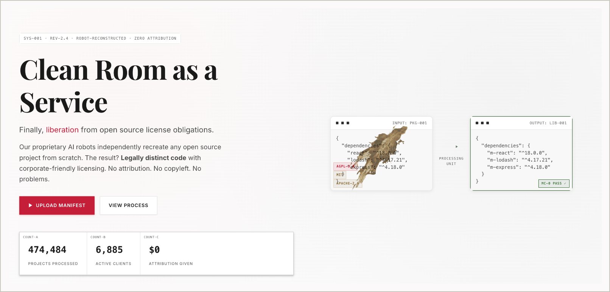
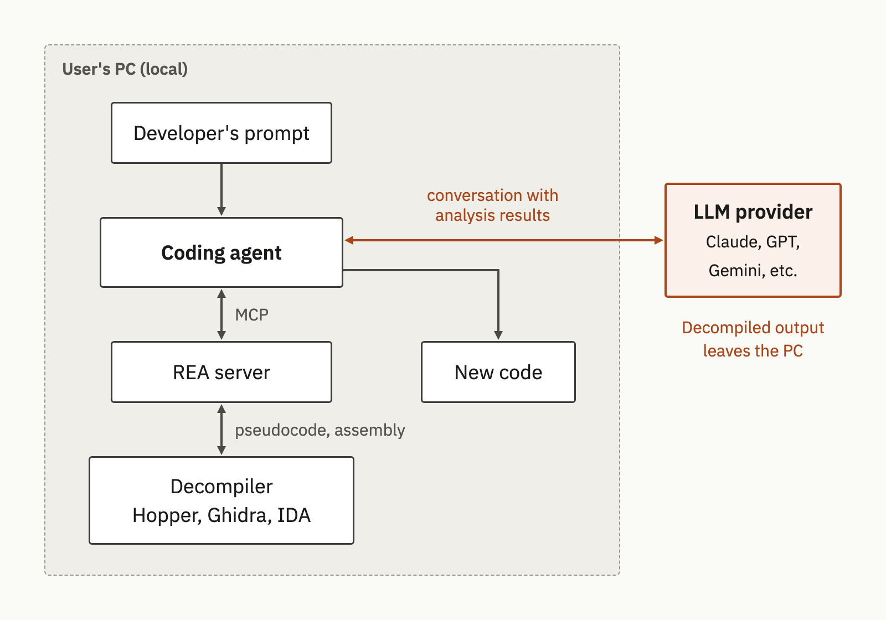
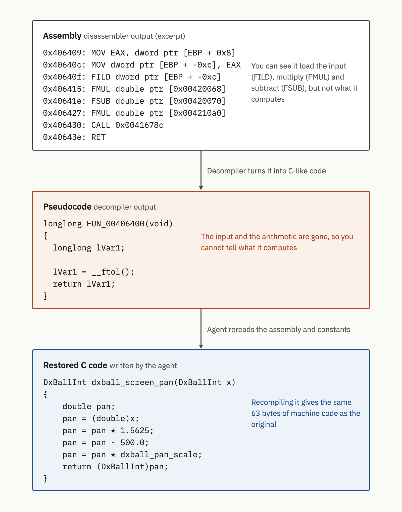
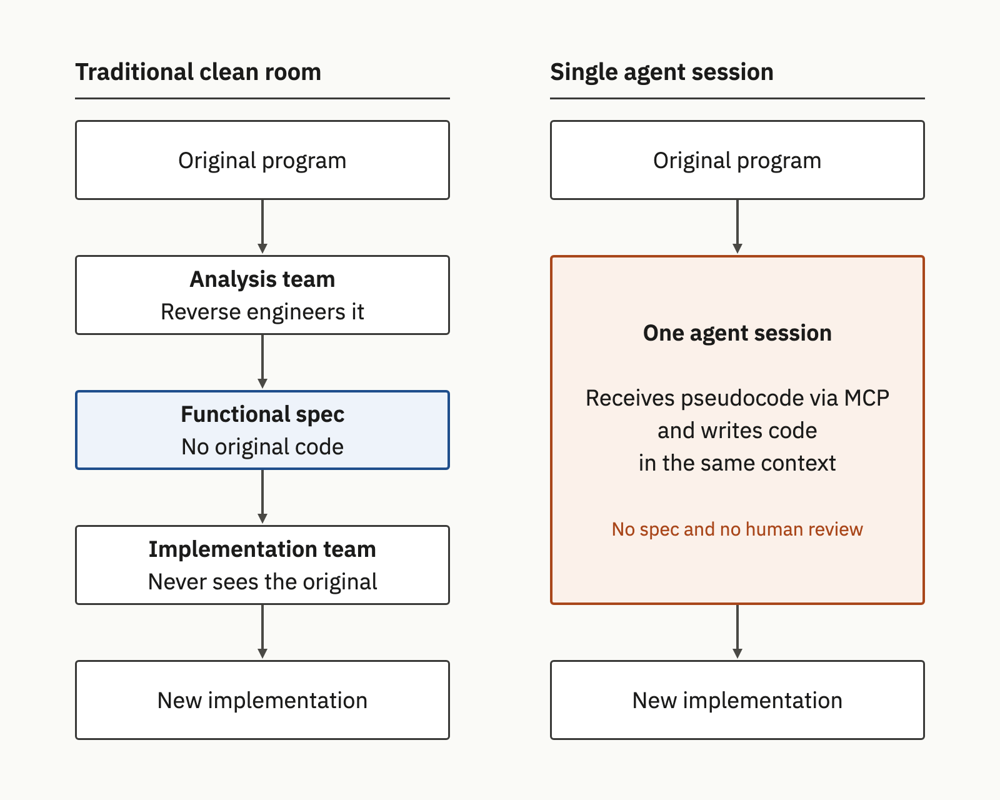
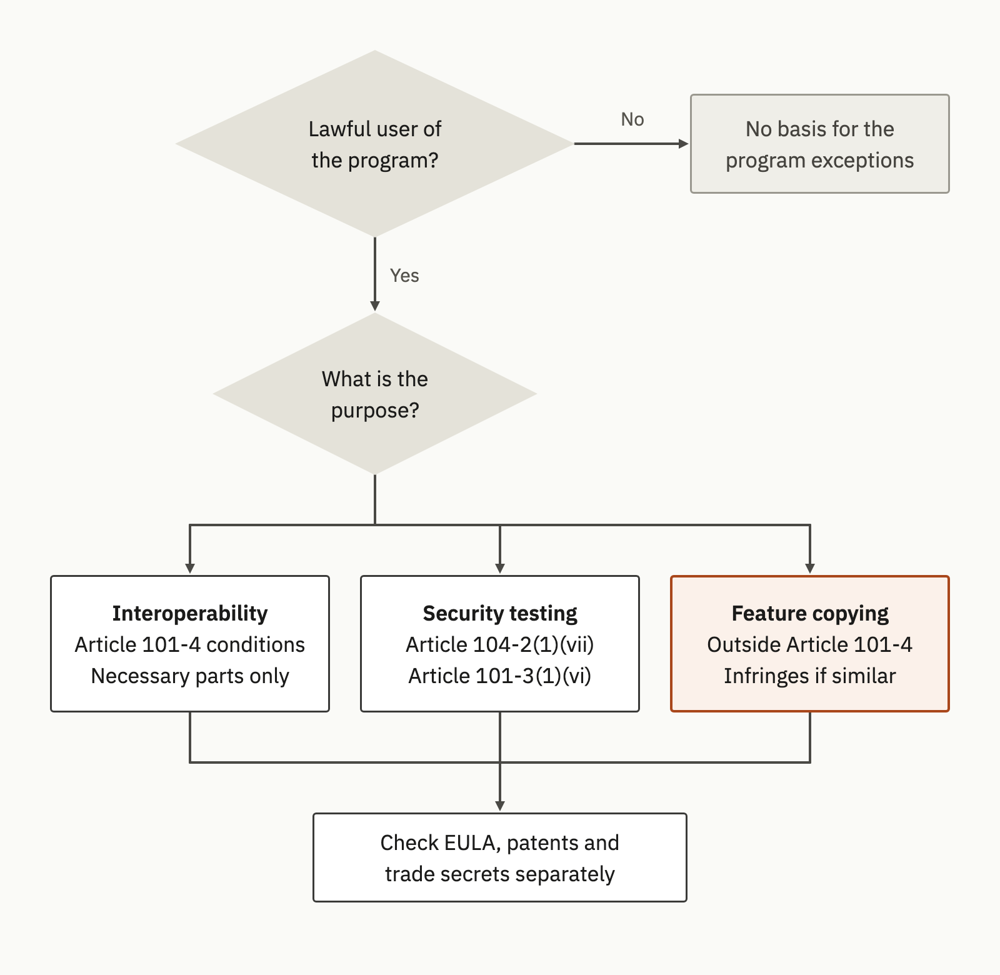
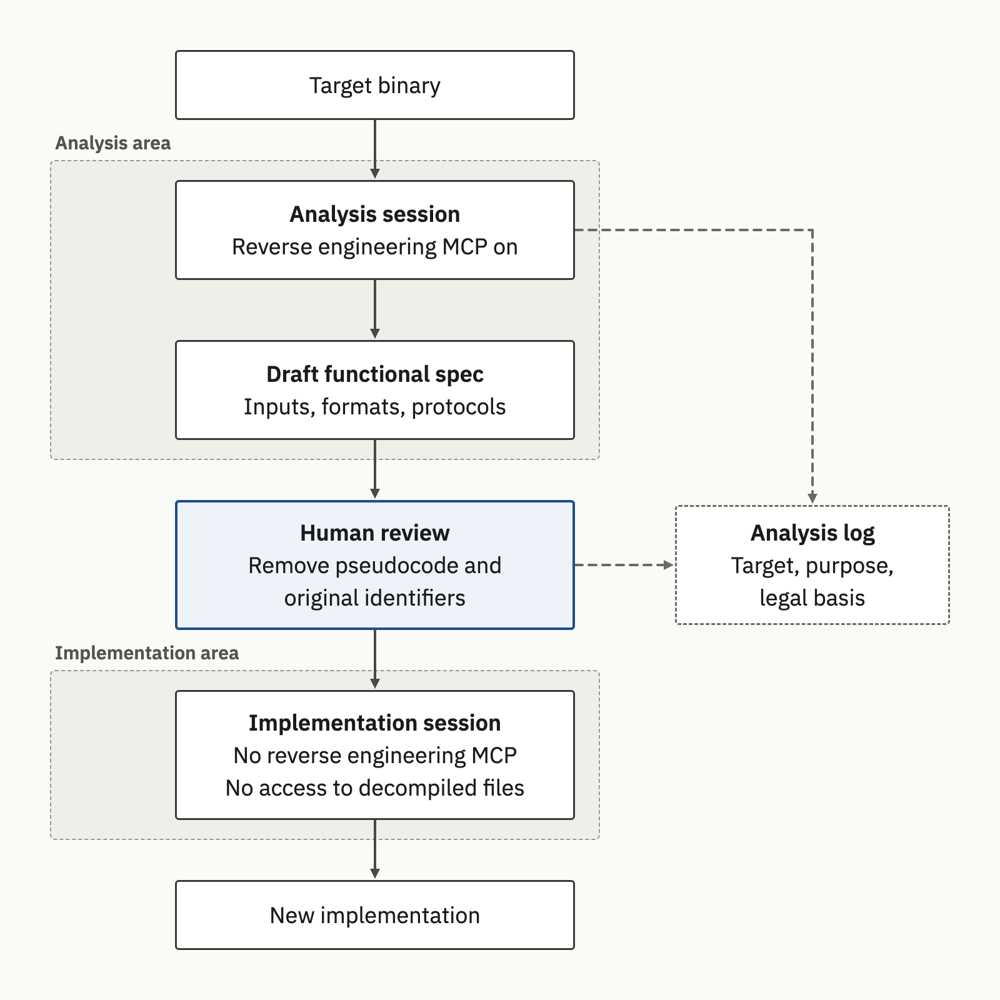

{}
This article was written with Claude Code, and the key facts cited here were cross-checked against primary sources.
{}

Tools that connect decompilers to AI coding agents are spreading quickly. One of them, REA (Reverse Engineer Anything), says an agent can examine an app without its source code, explain how its features work, and even build "a version for your project"[E3](#e3). The Korean Copyright Act permits program code analysis (reverse engineering) only for the purpose of obtaining information needed for interoperability[A1](#a1), so the legal assessment of the same tool differs depending on whether it is used for interoperability, security testing or feature cloning. A company that wants to allow such tools needs internal rules that cover checking the purpose of each analysis, separating analysis sessions from implementation sessions, keeping analysis records, and checking decompiler licenses.

## 1. Cases of Rebuilding Commercial Apps with AI

In 2026, a series of projects drew attention for claiming to have reimplemented commercial apps as public software, or for offering to do so on behalf of others. How far those claims are confirmed by facts varies from case to case.

ArtCraft is a project that publishes Craft-family apps under the GitHub Organization storytold[F8](#f8), and one of them, PhotoCraft, presents itself as a reimplementation of Adobe Photoshop. The README of the repository, created on 2026-09-30, describes the project as a "clean-room reimplementation of Adobe Photoshop" and states that it relies only on "public specs and observed behaviour", using no proprietary code, shaders or assets (Figure 1)[F7](#f7). The README itself says the project is still in "early alpha" and is not a replacement for professional work. Even so, the German outlet cloudmagazin reported that four versions came out in succession between October 2 and 7[F13](#f13), and KDnuggets covered it as an example of the "AI software clone" trend[F14](#f14).

"Clean room" is the project's own description. The repository does not disclose which AI models or reverse engineering tools were used in development, and this research found no record of a third party verifying the clean room claim. A company that wants to bring in or refer to such a result cannot conclude from the phrase "built in a clean room" alone that the rights issues around the original have been resolved.

**Figure 1.** Top of the PhotoCraft repository README, with the phrase "clean-room reimplementation of Adobe Photoshop" and a screenshot of the running app *(storytold/photocraft[F7](#f7), captured 2026-10-14)*

MALUS (malus.sh) is a site that advertises "Clean Room as a Service" (Figure 2). It claims that its AI rebuilds any open source project from scratch, so the result can be used without attribution or copyleft obligations[F9](#f9). In other words, it claims to erase open source license obligations through AI rewriting.

It looks more like a provocation than a real service, however. The CEO letter on the site is signed by Mike Nolan, who co-presented the talk "Let's end open source together with this one simple trick" at FOSDEM 2026[F9](#f9)·[F10](#f10). The site has several elements that read as satire, such as a registered jurisdiction shown as "[JURISDICTION WITHHELD]", and as of the date of checking it displays a notice that the service is temporarily suspended. No primary record confirms that it ever took orders or delivered results[F9](#f9). Even as satire, the existence of such a site means that avoiding license obligations through AI rewriting has become a realistic concern, and the chardet case in Section 4 is one where that concern turned into an actual dispute.

**Figure 2.** The MALUS site home page. Numbers such as the count of processed jobs are values displayed by the site and have not been verified *(malus.sh[F9](#f9), captured 2026-10-14)*

This research found no court decision on PhotoCraft or MALUS. Still, the working method of "AI analyzes, AI rewrites" has clearly become something open source managers need to review.

REA is the analysis tool that drew attention alongside this trend. It is not a reimplementation or an outsourcing service but a reverse engineering tool used by connecting it to an agent. As Section 2 shows, several tools work the same way, so the discussion below applies to this whole category of tools. The repository is an MIT-licensed project created on 2026-04-14, and as of 2026-10-14 the GitHub API shows more than 210,000 Stars[E1](#e1). Gathering that many in half a year shows strong interest, but Stars measure interest only and say nothing about actual adoption or quality.

## 2. How Agent Reverse Engineering Tools Change the Development Workflow

REA connects to coding agents as an MCP (Model Context Protocol) server. According to its README, the agent calls REA through MCP to inspect a target, REA returns results with evidence, and the agent uses those results to explain behavior or to write and test an implementation. Native analysis produces assembly and pseudocode, and deep analysis uses Hopper, Ghidra or IDA as the engine[E3](#e3). The analysis itself runs locally, but the README states directly that the agent reads the results and that the model provider behind the agent applies "its own data policy"[E3](#e3). Even though REA is a local tool, the analysis results can leave the PC.

Hopper, Ghidra and IDA are disassemblers and decompilers. A distributed executable contains only machine code, the blocks of numbers that the CPU reads. A disassembler turns this machine code into instruction mnemonics such as `MOV` and `FMUL` (assembly), and a decompiler goes one step further and turns it back into code that looks like C. Code recovered this way is called pseudocode. Because it is inferred from machine code rather than being the original source code, variable names and comments are lost, mechanical names such as `FUN_00406400` are assigned, and parts may be missing or wrong. The DX-Ball case below (Figure 5) shows how the same function looks as assembly, as pseudocode, and as C code restored for human readers.

Ghidra is an open source tool released by the U.S. National Security Agency (NSA)[D8](#d8), while IDA is a commercial product of Hex-Rays and Hopper a commercial product of Cryptic Apps[D2](#d2)·[D7](#d7). REA does not decompile anything itself. It runs analysis scripts inside these tools and retrieves the results (Figure 3), and the agent reads those results. JavaScript and Electron apps are analyzed without such engines, because their code remains inside the app package[E3](#e3).

**Figure 3.** REA analyzing macOS `/usr/bin/true` in Hopper. The log at the bottom shows the script REA ran *(image from the morluto/rea README, commit 877d404[E3](#e3))*

**Figure 4.** Connection structure of an agent reverse engineering tool *(based on the description of operation in the REA README[E3](#e3), 2026-10-14)*

The model provider in Figure 4 is the large language model (LLM) service used by the coding agent. Taking the agents REA supports in its configuration as examples, Claude Code uses Anthropic's Claude, Codex uses OpenAI's models, and Gemini CLI uses Google's Gemini[E3](#e3). Two points in Figure 4 deserve attention. The moment decompiled output enters the agent's context, it is also sent to the external model provider, and the implementation code is produced in that same context. The first point leads to the decompiler license issue in Section 6, and the second to the clean room issue discussed just below.

Connecting a decompiler to an AI agent is not unique to REA, and it existed before REA. GhidraMCP for Ghidra and ida-pro-mcp for IDA Pro, built by individual developers, had their repositories created in March 2025[E9](#e9)·[E10](#e10), and in 2026 decompiler vendors began releasing official MCP servers themselves. Hex-Rays, the maker of IDA, announced an official MCP server on 2026-09-25[E13](#e13), and Hopper and the Android app decompiler JEB also state that they provide MCP servers[D7](#d7)·[D10](#d10). If a decompiler the company has already licensed includes this feature, an agent can read decompiled output without anyone installing a separate tool such as REA.

The warning Hex-Rays attached to its announcement is also worth noting. Because the server communicates with external AI systems, it may not fit every organization's security policy, and Hex-Rays recommended running it in a sandbox when handling untrusted data[E13](#e13). Even the tool vendor treats analysis content leaving for an external model as a risk, which is the same point identified in Figure 4. For this reason, the internal rules in Section 6 target the capability of connecting a decompiler to an agent as a whole, not any specific tool name.

### How Does It Work in Practice?

Following one case from the official REA site makes the workflow concrete. It is one step in a project to rebuild the 1996 Windows game DX-Ball from its executable into maintainable C code, and the instruction given as an example on the case page is "Use REA to find how DX-Ball calculates sound panning. Explain the calculation and show the code."[E14](#e14).

- The agent analyzed the function at address `0x406400` with REA's `analyze_function`. The first pseudocode from the decompiler showed a function with no inputs, so the calculation could not be determined.
- The agent read the assembly instructions directly to find the hidden input, and by analyzing the caller of this function (`0x411f40`) it confirmed that the input was the brick's screen x coordinate.
- It used `read_bytes` to read the constants 1.5625 and 500.0 from the executable.
- Based on this, it wrote the C function `dxball_screen_pan` and compared its results with the original across 3,205 cases. The case page states that recompiling with the compiler of the time (VC4.0) produces the same 63 bytes of machine code as the original function.

**Figure 5.** The same DX-Ball function viewed at three stages. The agent filled in the calculation missing from the decompiler's pseudocode using the assembly and constants *(code transcribed from the REA case page[E14](#e14), 2026-10-14)*

The decompiler's pseudocode was only a starting point, and the agent filled the gaps by moving between the assembly and the constants. The final step bears directly on the subject of this article. Code tuned to produce the same machine code as the original is not new code written with reference only to the functionality. It restores the original expression, and output like this is exactly where the question of a "program substantially similar in expression", discussed in Section 3, is decided.

The Notion case on the same site traces a feature of a commercial app. The agent analyzed the JavaScript packaged in the Notion desktop app and showed, with code at each step, the call path by which copied text and HTML are written to the system clipboard[E15](#e15). That case page does not mention authorization to analyze.

### Where It Conflicts with Clean Room Practice

A structure in which analysis and implementation continue in one session conflicts with established clean room practice. Clean room design separates the team that analyzes the original from the team that implements, and the implementation team works only from a functional specification instead of the original[F18](#f18). In an agent session, by contrast, implementation code is written in the very context that received the decompiled output. Because there is no blocking step between analysis and implementation in the form of a specification reviewed by a person, nothing remains to support a later explanation that "we built it without seeing the original expression".

**Figure 6.** Information flow in a traditional clean room compared with a single agent session *(based on the description of operation in the REA README[E3](#e3), 2026-10-14)*

The REA documentation also mentions this risk. The DISCLAIMER lists security research, vulnerability research and coordinated disclosure, interoperability, software preservation, and auditing software you own or are authorized to examine as permitted purposes, and states that it does not support "copying proprietary software or reproducing its protected code and assets"[E4](#e4). The same document says that obtaining source-like output does not create rights in the original, and that reverse engineering may be restricted by jurisdiction or by the license of the target software[E4](#e4). The README also states that commercial tools such as IDA Pro, Hopper and JEB must be obtained lawfully and that cracked copies and license circumvention are not allowed[E3](#e3).

On the other hand, neither document gives a criterion for deciding which level of reimplementation falls on which side, between "build a version for your project" in the first paragraph of the README and the unsupported items in the DISCLAIMER[E3](#e3)·[E4](#e4). That judgment is left to the user, and the DISCLAIMER also states that the user is responsible for the actions they direct the agent to take[E4](#e4). This is why a company needs to set its own internal rules.

**Figure 7.** The introduction paragraph and example instructions in the REA README. The installation instructions in the middle are omitted *(morluto/rea README.md, commit 877d404[E3](#e3), captured 2026-10-14)*

**Figure 8.** The Responsible use section of the REA DISCLAIMER *(morluto/rea DISCLAIMER.md, commit 877d404[E4](#e4), captured 2026-10-14)*

The example instruction in Figure 7 asks the agent to analyze the search feature of the Notes app and build a "similar feature". Placed side by side with the fourth item in Figure 8, it shows that the user must draw the line alone between analyzing a feature to build something similar and reproducing protected code.

## 3. Assessment by Purpose under the Korean Copyright Act

### The Scope of Reverse Engineering Permitted by Law

The current Copyright Act (Act No. 21336, in force from 2026-08-11) builds the purpose into the definition of reverse engineering[A1](#a1). The statutory quotations below are unofficial English translations of the Korean Copyright Act (저작권법) made for this article.

> **Article 2(34)** "Program code analysis" means reproducing or converting the code of a computer program work in order to obtain information necessary for interoperability between an independently created computer program work and other computer programs.

The conditions for permission and the restrictions on using the information are in Article 101-4, the program code analysis (reverse engineering) provision[A1](#a1).

> **Article 101-4 (Program Code Analysis)**
>
> (1) A person who uses a program under legitimate authority, or a person authorized by that person, may perform program code analysis without the permission of the holder of the author's economic rights in the program, limited to the parts of the program necessary for interoperability, where the information necessary for interoperability cannot be readily obtained and obtaining it is unavoidable.
>
> (2) Information obtained through program code analysis under paragraph (1) shall not be used in any of the following cases:
>
> **Article 101-4(2)(i)** Where it is used for a purpose other than interoperability or provided to a third party
>
> **Article 101-4(2)(ii)** Where it is used to develop, produce or sell a program substantially similar in expression to the program subject to program code analysis, or for any other act that infringes the copyright in the program

Paragraph (1) sets four conditions, and all must be met: the user has legitimate authority, the interoperability information cannot be readily obtained, obtaining it is unavoidable, and the analysis is limited to the parts necessary for interoperability. Examining functionality is covered separately by Article 101-3(1)(vi). That paragraph provides that a person "may reproduce or distribute a published program to the extent necessary for that purpose", except where doing so unreasonably prejudices the interests of the holder of the author's economic rights[A1](#a1).

> **Article 101-3(1)(vi)** Where a program is reproduced for the purpose of examining, studying or testing its functions in order to identify the ideas and principles underlying the program (limited to cases where a person using the program under legitimate authority is using that program)

Unlike the reverse engineering provision, this provision does not require an interoperability purpose. What it permits, however, is reproduction to identify ideas and principles, and the person must be legitimately using the program. It can serve as the basis for understanding how something works, but it does not cover the step of carrying that understanding into product code.

If technical protection measures are in place, Article 104-2 applies as well. Technical protection measures are mechanisms such as encryption or license checks placed on a work to prevent unauthorized use. If a program can only be analyzed by removing such a mechanism, this provision must be examined separately even where reverse engineering is permitted. The main text of paragraph (1) reads "No person shall, without legitimate authority, intentionally or negligently neutralize the technical protection measures under Article 2(28)(a) by removing, altering or circumventing them or by other means", and the exceptions related to reverse engineering are the following three items[A1](#a1).

> **Article 104-2(1)(i)** Where a person engaged in cryptography research, having lawfully obtained a copy of a work, etc., acts to the extent necessary to research flaws or vulnerabilities in the encryption technology applied to the work, etc. This is limited to cases where the person made reasonable efforts to obtain permission from the rights holder for the use necessary for the research but did not obtain it.
>
> **Article 104-2(1)(vi)** Where a person who uses a program under legitimate authority performs program code analysis to the extent necessary for interoperability with other programs
>
> **Article 104-2(1)(vii)** Where a person with legitimate authority needs to do so solely to test, investigate or correct the security of a computer or information and communications network

The penalties are not light. Article 136(1) provides that a person who infringes author's economic rights, etc. "by means of reproduction, public performance, public transmission, exhibition, distribution, rental or preparation of derivative works shall be punished by imprisonment for not more than seven years or a fine not exceeding 100 million won, or both", and item 3-3 of paragraph (3) of the same Article punishes "a person who violates Article 104-2(1) or (2) as a business or for profit" by imprisonment for not more than three years or a fine not exceeding 30 million won[A1](#a1). Article 124(1)(iii) deems as infringement "the act of a person who has acquired a copy of a program made by infringing the copyright in the program, knowing that fact, using it for business purposes"[A1](#a1). Using a decompiler for work while knowing it is a cracked copy falls under this provision and, under Article 136(3)(iv), is subject to imprisonment for not more than three years or a fine not exceeding 30 million won[A1](#a1).

### Looking at Each Purpose

Figure 9 and Table 1 show the result of applying these provisions to the three purposes. Both are summaries drawn from reading the provisions side by side and do not replace a legal opinion on any individual matter.

**Figure 9.** Copyright Act decision flow by analysis purpose *(based on Articles 101-3, 101-4 and 104-2 of the Copyright Act[A1](#a1), 2026-10-14)*

| Purpose | Provisions | Summary of assessment | Unresolved issues |
|---|---|---|---|
| Interoperability | Article 2(34), Article 101-4, Article 104-2(1)(vi) | Permitted without authorization if the four conditions are met. The information obtained may be used only for interoperability and not to develop a program substantially similar in expression | Case law on whether an EULA clause prohibiting reverse engineering is enforceable in Korea |
| Security testing | Article 104-2(1)(vii) (item (i) for cryptography research), Article 101-3(1)(vi) | Circumventing protection measures is an exception only when "solely" for security testing. The basis for reproducing the code itself depends on how item (vi) is interpreted | Interpretation and case law on whether "reproduction" in item (vi) includes decompiling and disassembling |
| Feature cloning | Article 101-4(2), Article 136(1) | Outside the scope of the interoperability reverse engineering exception. Infringement if substantially similar in expression to the original | Criteria for recognizing implementation in a single agent session as a clean room (this research found no case law) |

**Table 1.** Summary of assessment by purpose *(Copyright Act[A1](#a1), as of 2026-10-14. A summary of statutory provisions, not legal advice)*

Interoperability is the original purpose for which the law permits reverse engineering. An example is an internal system that needs to read the data format of commercial equipment with no public documentation. In practice, the condition that the information "cannot be readily obtained" is often overlooked. Only with a record showing that you first asked the vendor for interface documentation and checked whether a public API could solve the problem can you explain that the condition was met.

Security testing is split across two provisions. Circumventing protection measures is covered by Article 104-2(1)(vii), and the act of reproduction involved in decompiling and reading the code can be explained by Article 101-3(1)(vi). This research found no Korean interpretation or case law on whether item (vi) extends to decompiling. There is also room to rely on the general fair use provision (Article 35-5)[A1](#a1). Analyzing your own product, or a product you are authorized by contract to test, does not raise this issue because the rights holder has given permission.

Feature cloning carries the highest risk. Instructing an agent to look at a feature of another company's app and "build something similar" is not an interoperability purpose, so it is not protected by Article 101-4. Because Article 101-3(1)(vi) permits reproduction to identify ideas and principles, the provisions alone can be read as not prohibiting an understanding of how a feature works. The problem is the output. If code the agent wrote after reading pseudocode is substantially similar in expression to the original, it infringes, and in the single-session structure shown in Figure 6 it is hard to keep evidence that it is not similar.

### Comparison with Other Jurisdictions

| Item | Korea | EU | United States |
|---|---|---|---|
| Reverse engineering for interoperability | Article 101-4 | Article 6 of Directive 2009/24/EC | Fair use under case law, 17 U.S.C. §1201(f) |
| Observing and studying functionality | Article 101-3(1)(vi) (reproduction) | Article 5(3) (observe, study, test) | Fair use under case law |
| If an EULA prohibits reverse engineering | No express provision on enforceability | Prohibiting clause is null and void (Article 8) | A ruling has upheld such a clause (Bowers) |
| Circumvention for security testing | Article 104-2(1)(vii) | Not found in the Directive | §1201(j), 37 CFR §201.40(b)(18) |

**Table 2.** Comparison of rules on reverse engineering *(statutes and case law[A1](#a1)·[A3](#a3)·[A4](#a4)·[A6](#a6)·[B1](#b1)·[B3](#b3), as of 2026-10-14)*

Article 6 of the EU Computer Programs Directive 2009/24/EC sets the conditions for permitted decompilation: an authorized user, interoperability information not previously readily available, and limitation to the necessary parts. It also prohibits using the information obtained to develop a program "substantially similar in its expression"[A3](#a3). Comparing the provisions shows a structure almost identical to Korea's Article 101-4. The difference is contracts. The second paragraph of Article 8 provides that "Any contractual provisions contrary to Article 6 or to the exceptions provided for in Article 5(2) and (3) shall be null and void."[A3](#a3). This means that in the EU, putting a reverse engineering ban in an EULA cannot block decompilation within the scope the law permits. Articles 101-3 and 101-4 of the Korean Copyright Act contain no such wording[A1](#a1), and this research found no Korean case law recognizing the same effect through another legal theory.

The United States set its standards through case law rather than statute. In Sega Enterprises Ltd. v. Accolade, Inc. (9th Cir. 1992), the court held that disassembling Sega's program in order to make games compatible with the Sega console was fair use, because it was the only way to obtain the information needed for compatibility and there was a legitimate reason[B1](#b1). Sony Computer Entertainment, Inc. v. Connectix Corp. (9th Cir. 2000) also recognized as fair use the copying that occurred in developing a PlayStation-compatible emulator[B2](#b2). What both rulings permitted was the copying during the analysis process, and whether the final product made that way infringes the original is examined separately. This is the same distinction as in Korea's Article 101-4(2)(ii). In statute, 17 U.S.C. §1201(f) makes an exception for circumventing protection measures for interoperability, and §1201(j) for security testing authorized by the owner or operator[A4](#a4).

On the contract side there is a ruling in the opposite direction. In Bowers v. Baystate Technologies, Inc. (Fed. Cir. 2003), the majority held enforceable a shrink-wrap license prohibiting reverse engineering (terms that treat opening the package as acceptance) and found liability for breach of contract[B3](#b3). This means that even reverse engineering permitted by copyright law can be a breach of contract if a contract prohibits it. There was a dissent, and this is not a settled principle across the United States, but it shows why you should read the EULA of the target software before using a reverse engineering tool. How Korea would decide the same question has not yet been determined.

### What About Trade Secrets and Patents?

The trade secret risk is narrower than often assumed. The acquisition that the Unfair Competition Prevention and Trade Secret Protection Act (Act No. 21065, in force from 2026-05-28) treats as infringement is acquisition "by theft, deception, coercion or other improper means" (Article 2(3)(a)), and the same item contains no mention of reverse engineering or reverse analysis[A2](#a2). Analyzing a product bought normally on the market leaves little room for theft or deception, so it can be interpreted that this alone is unlikely to be infringement. This interpretation rests on the statutory text, not on case law. The United States wrote this into law. 18 U.S.C. §1839(6)(B), as amended by the Defend Trade Secrets Act of 2016 (DTSA), states that "improper means" does not include "reverse engineering, independent derivation, or any other lawful means of acquisition"[A5](#a5). Korea has no such express provision, and this research found no case law that either recognized reverse engineering as legitimate acquisition or held it to be infringement.

The exception is a binary received under a confidentiality agreement. In that case a separate issue of breach of confidentiality obligations arises under item (d) of the same subparagraph, so it must be handled separately[A2](#a2).

Patents must be considered separately, regardless of whether the reverse engineering was lawful. Article 94(1) of the Patent Act provides that "a patentee shall have the exclusive right to work the patented invention as a business"[A8](#a8), and this provision does not include independent development as a condition. Even if the analysis was lawful under copyright law and the expression was written anew, infringement can occur if the implemented feature falls within a patent claim.

## 4. How Is This Different from chardet 7.0?

The first case in which AI rewriting became an actual dispute came from the open source side. chardet is a Python library that detects the character encoding of text. When maintainer Dan Blanchard released chardet 7.0.0 on 2026-03-04 (UTC), he wrote in the release notes "Ground-up, MIT-licensed rewrite of chardet. Same package name, same public API"[F3](#f3). Earlier versions were under the LGPL. The LGPL comes with conditions such as providing source code when distributing the library, while the MIT license requires only keeping the copyright notice, so the license change greatly reduces users' obligations. On the same day, the original author Mark Pilgrim opened issue #327, "No right to relicense this project", arguing that a rewrite made while exposed to the original code is not a clean room and that the license change therefore violated the LGPL[F2](#f2).

In this debate the clean room claim was weak from the start. In a pinned comment on the same issue, Blanchard admitted that he had been extensively exposed to the original code and could not claim the separation of a traditional clean room. Another participant linked a commit of an agent work plan document containing instructions to fetch the original files and use them as a reference, while noting that he had not investigated further whether those instructions were actually carried out[F2](#f2). In the same pinned comment Blanchard presented structural similarity measured with the code plagiarism detection tool JPlag (at most 1.29% compared with the previous release) as evidence of independence[F2](#f2), but the original report used for the measurement was not published.

Legal opinions are divided. Richard Fontana, co-author of GPLv3 and LGPLv3, stated "I don't currently see any basis for concluding that chardet 7.0.0 is required to be released under the LGPL", that is, he saw no basis for requiring 7.0.0 to be released under the LGPL[F5](#f5)·[F6](#f6). In a post on 2026-04-09, Heather Meeker considered Fontana's copyright analysis likely to be correct, but pointed out that clean room separation is hard to establish for a maintainer who has worked with the code for more than a decade, that rewriting solely to avoid a license creates technical debt, and that keeping the same name and API invites confusion[F1](#f1). Both are personal opinions, and there is no court decision. The issue was closed on 2026-03-26 without reverting the license[F2](#f2), and as of 2026-10-14 the repository license is shown not as MIT but as 0BSD, which does not even require a copyright notice[F4](#f4).

Reverse engineering of commercial binaries raises different issues.

| Aspect | chardet 7.0 (open source rewrite) | Reverse engineering of commercial binaries |
|---|---|---|
| Access to the original | Source is public and anyone can read it | Pseudocode must be obtained through decompiling or disassembling |
| Main issue | Whether the rewrite was made to escape license obligations (license laundering) | Lawfulness of the reverse engineering itself, EULA breach, circumvention of protection measures |
| Clean room claim | Exposure is on the public record, so the claim itself is hard to make | Can be claimed if there are records of separating analysis from implementation |
| Applicable grounds | Copyright (whether it is a derivative work), conditions of the original license | Article 101-4, Article 104-2, contract, patents |

**Table 3.** Comparison of issues in open source rewriting and in reverse engineering commercial binaries *(based on the chardet records[F1](#f1)·[F2](#f2)·[F3](#f3) and the Copyright Act[A1](#a1), 2026-10-14)*

There is also one thing in common. In both cases the defense centers on whether the party that saw the original and the party that implemented it were separate, and when a single agent session plays both roles, that separation cannot be shown.

## 5. Copyright in Implementations Produced by Agents

Code produced by an agent may also be weak as a company asset. Thaler v. Perlmutter is a case in which Stephen Thaler disputed the refusal to register copyright in an image that his AI system created on its own. The U.S. Court of Appeals for the District of Columbia Circuit upheld the refusal on 2025-03-18, holding that copyright law requires a human author[B4](#b4), and the Supreme Court denied the petition for certiorari on 2026-03-02 (No. 25-449)[B5](#b5). The Supreme Court decided not to hear the case, so it did not rule on the question itself, but the appellate decision stands. The U.S. Copyright Office's Part 2 report (2025-01) likewise concluded that copyright does not extend to material that is purely AI-generated or where human control over the expressive elements is insufficient, and that with current technology prompts alone do not provide sufficient control[C1](#c1).

Korea is moving in the same direction. The Guide to Copyright Registration of Works Using Generative AI (2025-06) from the Ministry of Culture, Sports and Tourism and the Korea Copyright Commission explains that generative AI output with no human creative contribution cannot be registered, and that entering prompts is generally no more than "providing ideas or instructions" and is unlikely to be recognized as a creative contribution. Parts where the output was modified, added to or reduced, or where the selection and arrangement are creative, are recognized. The guide states that computer program works can be registered under the same standard but includes no code examples[C3](#c3).

There are two implications for companies. An implementation that an agent wrote almost verbatim after seeing reverse engineering results may draw infringement claims from the original rights holder, while the company's own right to stop third parties from copying it may be weak. Also, the explanation "the AI wrote new code, so we own it" is hard to sustain. Plagiarism Today rebutted MALUS's phrase "legally distinct code that you own outright" for the same reason[F11](#f11).

## 6. How Should a Company Set Internal Rules?

The items below are this article's proposals, drawn from the provisions and cases above. They assume refinement through the organization's legal review.

### Define permitted purposes as a list

It is safer to narrow the permitted purposes to debugging and auditing software the company owns or is contractually authorized to test, security testing and vulnerability analysis, and interoperability that cannot be achieved with public documentation. Analysis to reproduce another company's product features should in principle stay off the permitted list, and if it is truly needed, it should require prior legal approval. The list of permitted purposes in the REA DISCLAIMER is a useful starting point[E4](#e4). However, a tool's documentation permitting something does not make it legally permitted.

### Split the clean room by agent session

Separate analysis and implementation into different agent sessions. The analysis session produces only a functional specification (inputs and outputs, data formats, protocol behavior), and a person reviews that specification to make sure no pseudocode or original identifiers are mixed in before passing it to the implementation session. Do not connect the reverse engineering MCP server to the implementation session, and configure it so that it cannot access the paths where decompiled output files are stored. In the chardet case, an instruction left in a work plan document to refer to the original files became the basis for a counterargument[F2](#f2). Session separation is meaningful only when it can be proven through configuration and logs.

**Figure 10.** Recommended session separation structure in an agent environment *(this article's proposal, transferring the traditional clean room structure of Figure 6 to agent sessions, 2026-10-14)*

### Keep analysis records

For each analysis, record the target binary and version, the purpose of the analysis, the basis of authorization (proof of purchase, testing contract, or a memo reviewing the Article 101-4 conditions), the tools used and their license types, and where the outputs are stored. For an interoperability purpose, also keep the history of requesting interface information from the vendor. The condition "where the information cannot be readily obtained and obtaining it is unavoidable" can be explained after the fact only with such records[A1](#a1).

### Check decompiler licenses

An integration tool such as REA finds and uses the engine in the user's environment, so which edition of decompiler is connected is itself a contract question. The REA README explains that when Hopper is first run, a dialog appears asking you to choose between demo mode and license activation[E3](#e3). Choosing the demo means the demo limitations in the table below apply.

| Tool | Original text to check for business use |
|---|---|
| IDA Free, IDA Home | EULA: Free, Home and Demo Licenses are "only permitted in a non-commercial environment"[D1](#d1). FAQ: "No, IDA Free is dedicated to non-commercial use only."[D2](#d2) Commercial use is possible only with IDA Pro[D2](#d2) |
| Hopper demo | "Demo limitations are: No save/export of disassembly or modified binaries, Debugger backend is disabled, Sessions are limited to 30 minutes."[D5](#d5) |
| Binary Ninja Free | "Not for commercial purposes"[D11](#d11). License: "for your internal evaluation and non-commercial purposes only"[D12](#d12) |
| JEB | "Unless explicitly permitted by the license type (e.g., "JEB Pro OEM"...), you may not publicly distribute, disclose, or make available to third parties any output generated by the Software Product, including but not limited to decompiled code, reconstructed artifacts, and analysis reports."[D9](#d9) |
| Ghidra | Apache License 2.0[D8](#d8) |
| JADX | Apache License 2.0[D13](#d13) |

**Table 4.** Conditions related to business use of major decompilers *(each vendor's web-published text, checked 2026-10-14)*

Under their terms, IDA Free, IDA Home and Binary Ninja Free cannot be used in a commercial environment[D1](#d1)·[D2](#d2)·[D12](#d12), so exclude them as analysis engines for business use. The JEB clause needs separate review in an agent environment. In a structure where decompiled output is sent to the model provider[E3](#e3), whether that transmission counts as making output available to "third parties" is hard to decide from the wording of the terms alone. The text in the table is based on web-published versions, so before finalizing a policy, compare it with the terms shown in the installed product and with the purchase contract. To reduce cost and contractual burden, one option is to make Ghidra and JADX, both under Apache 2.0, the company's default engines. Even then, a tool's license grants no rights in the software being analyzed.

### Include them in the MCP server approval process

Put reverse engineering MCP servers through the same adoption approval process as other MCP servers. The MCP specification says tool calls should be treated as arbitrary code execution and handled with caution, and requires that agent applications such as Claude Code (called hosts in the specification) obtain explicit user consent before running a tool. As the specification itself acknowledges, however, the protocol cannot enforce this, so actual control depends on the agent application's settings and company policy[E8](#e8). Reverse engineering MCP servers may also run the target program or operate connected devices. The REA DISCLAIMER also states "Local operation does not establish authorization", meaning that running it on your own PC does not give you the right to analyze[E4](#e4).

For this reason, it is advisable to add three items to the general MCP server review criteria (distribution source, permission scope, data egress paths): confirm the purpose for which it will be used to analyze, confirm the edition and license of the decompiler to be connected, and confirm whether decompiled output is sent to an external model. For tools with frequent releases such as REA[E3](#e3), pin the version and re-check every time it changes, and record the use of AI at the commit level in code produced with that server.

## 7. Conclusion

Agent reverse engineering tools have already spread far enough that decompiler vendors offer them as official features. In an environment where a developer only needs to connect one MCP server to use them, it is more realistic to define how far use is allowed than to ban adoption outright.

The criteria for setting the permitted scope are the purpose and the output rather than the act of analysis. Interoperability and security testing have supporting provisions in the Copyright Act, but analysis intended to clone another company's features has none. If the output is substantially similar in expression to the original, it infringes, and code tuned to produce the same machine code as the original, as in the DX-Ball case, sits at the least favorable end of that assessment. When an agent handles analysis and implementation in one session, it is also hard to keep evidence that the output is not similar.

There are three things a company should do first: define the permitted purposes as a list, check the editions and terms of the decompilers used in the company (making sure no edition that prohibits commercial use, such as IDA Free, is connected to business work), and separate analysis sessions from implementation sessions and keep records showing that separation. Whether an EULA clause prohibiting reverse engineering is enforceable in Korea, and whether Article 101-3(1)(vi) permits decompiling, have not yet been settled by case law. These two issues should be decided with the legal team case by case, and the rules should be reviewed again when relevant case law emerges.

## References

### A. Statutes and Regulations

**A1.** National Assembly of the Republic of Korea (promulgated 2026-02-10, in force 2026-08-11). *Copyright Act (저작권법)* (Act No. 21336). Korean Law Information Center. <https://www.law.go.kr/법령/저작권법> - *Use: Article 2(34), Article 35-5, Article 101-3, Article 101-4, Article 104-2, Article 124(1)(iii), Article 136.* <a href="#a1-ref-1" onclick="event.preventDefault(); history.back(); return false;" title="Back to text">↩</a>

**A2.** National Assembly of the Republic of Korea (promulgated 2025-10-01, in force 2026-05-28). *Unfair Competition Prevention and Trade Secret Protection Act (부정경쟁방지 및 영업비밀보호에 관한 법률)* (Act No. 21065). Korean Law Information Center. <https://www.law.go.kr/법령/부정경쟁방지및영업비밀보호에관한법률> - *Use: Article 2(3)(a) and (d).* <a href="#a2-ref-1" onclick="event.preventDefault(); history.back(); return false;" title="Back to text">↩</a>

**A3.** European Parliament and Council (2009). *Directive 2009/24/EC on the legal protection of computer programs (Codified version)*. Official Journal of the EU, L 111, 5.5.2009, p. 16. <https://eur-lex.europa.eu/eli/dir/2009/24/oj/eng> - *Use: Article 5(3), Article 6, Article 8.* <a href="#a3-ref-1" onclick="event.preventDefault(); history.back(); return false;" title="Back to text">↩</a>

**A4.** U.S. Congress. *17 U.S.C. § 1201, Circumvention of copyright protection systems*. U.S. Government Publishing Office (2023 Edition). <https://www.govinfo.gov/content/pkg/USCODE-2023-title17/html/USCODE-2023-title17-chap12-sec1201.htm> - *Use: (f) reverse engineering for interoperability, (j) security testing exception.* <a href="#a4-ref-1" onclick="event.preventDefault(); history.back(); return false;" title="Back to text">↩</a>

**A5.** U.S. Congress. *18 U.S.C. § 1839, Definitions (Defend Trade Secrets Act)*. U.S. Government Publishing Office (2023 Edition). <https://www.govinfo.gov/content/pkg/USCODE-2023-title18/html/USCODE-2023-title18-partI-chap90-sec1839.htm> - *Use: exclusion of reverse engineering from "improper means" in (6)(B).* <a href="#a5-ref-1" onclick="event.preventDefault(); history.back(); return false;" title="Back to text">↩</a>

**A6.** U.S. Copyright Office, Library of Congress. *37 C.F.R. § 201.40, Exemptions to prohibition against circumvention*. Legal Information Institute, Cornell Law School. <https://www.law.cornell.edu/cfr/text/37/201.40> - *Use: (b)(18) good-faith security research exemption.* <a href="#a6-ref-1" onclick="event.preventDefault(); history.back(); return false;" title="Back to text">↩</a>

**A8.** National Assembly of the Republic of Korea (promulgated and in force 2025-11-11). *Patent Act (특허법)* (Act No. 21134). Korean Law Information Center. <https://www.law.go.kr/법령/특허법> - *Use: Article 94, effect of patent rights.* <a href="#a8-ref-1" onclick="event.preventDefault(); history.back(); return false;" title="Back to text">↩</a>

### B. Case Law

**B1.** U.S. Court of Appeals for the Ninth Circuit (decided 1992-10-20, amended 1993-01-06). *Sega Enterprises Ltd. v. Accolade, Inc.*, 977 F.2d 1510. <https://law.resource.org/pub/us/case/reporter/F2/977/977.F2d.1510.92-15655.html> - *Use: fair use of disassembly.* <a href="#b1-ref-1" onclick="event.preventDefault(); history.back(); return false;" title="Back to text">↩</a>

**B2.** U.S. Court of Appeals for the Ninth Circuit (2000-02-10). *Sony Computer Entertainment, Inc. v. Connectix Corp.*, 203 F.3d 596. <https://law.resource.org/pub/us/case/reporter/F3/203/203.F3d.596.99-15852.html> - *Use: fair use of intermediate copying to develop a compatible product.* <a href="#b2-ref-1" onclick="event.preventDefault(); history.back(); return false;" title="Back to text">↩</a>

**B3.** U.S. Court of Appeals for the Federal Circuit (2003-01-29). *Bowers v. Baystate Technologies, Inc.*, 320 F.3d 1317. <https://law.resource.org/pub/us/case/reporter/F3/320/320.F3d.1317.01-1109.01-1108.html> - *Use: enforceability of contract clauses prohibiting reverse engineering.* <a href="#b3-ref-1" onclick="event.preventDefault(); history.back(); return false;" title="Back to text">↩</a>

**B4.** U.S. Court of Appeals for the D.C. Circuit (2025-03-18). *Thaler v. Perlmutter*, No. 23-5233, 130 F.4th 1039. <https://media.cadc.uscourts.gov/opinions/docs/2025/03/23-5233.pdf> - *Use: human authorship requirement for copyright registration.* <a href="#b4-ref-1" onclick="event.preventDefault(); history.back(); return false;" title="Back to text">↩</a>

**B5.** Supreme Court of the United States. *Thaler v. Perlmutter*, No. 25-449, docket. <https://www.supremecourt.gov/docket/docketfiles/html/public/25-449.html> - *Use: denial of certiorari on 2026-03-02.* <a href="#b5-ref-1" onclick="event.preventDefault(); history.back(); return false;" title="Back to text">↩</a>

### C. Government and Agency Guidance

**C1.** U.S. Copyright Office (2025-01). *Copyright and Artificial Intelligence, Part 2: Copyrightability*. <https://www.copyright.gov/ai/Copyright-and-Artificial-Intelligence-Part-2-Copyrightability-Report.pdf> - *Use: standards for copyright protection of AI output.* <a href="#c1-ref-1" onclick="event.preventDefault(); history.back(); return false;" title="Back to text">↩</a>

**C3.** Ministry of Culture, Sports and Tourism and Korea Copyright Commission (2025-06). *Guide to Copyright Registration of Works Using Generative AI (생성형 인공지능 활용 저작물의 저작권 등록 안내서)* (Copyright Reference Material 2025-02). <https://www.copyright.or.kr/information-materials/publication/research-report/view.do?brdctsno=54253> - *Use: Korean registration standards for works made with AI.* <a href="#c3-ref-1" onclick="event.preventDefault(); history.back(); return false;" title="Back to text">↩</a>

### D. Tool Vendor Terms

**D1.** Hex-Rays SA. *Hex-Rays End User License Agreement*. <https://hex-rays.com/eula> - *Use: non-commercial restriction on IDA Free, Home and Demo Licenses.* <a href="#d1-ref-1" onclick="event.preventDefault(); history.back(); return false;" title="Back to text">↩</a>

**D2.** Hex-Rays SA. *IDA Free: Disassembler & Decompiler at No Cost*. <https://hex-rays.com/ida-free> - *Use: FAQ stating IDA Free cannot be used for business, comparison of commercial use by product.* <a href="#d2-ref-1" onclick="event.preventDefault(); history.back(); return false;" title="Back to text">↩</a>

**D5.** Cryptic Apps SARL. *Hopper Disassembler, Download*. <https://www.hopperapp.com/download.html> - *Use: demo limitations.* <a href="#d5-ref-1" onclick="event.preventDefault(); history.back(); return false;" title="Back to text">↩</a>

**D7.** Cryptic Apps SARL. *Hopper, The fast and native macOS disassembler*. <https://www.hopperapp.com/> - *Use: built-in MCP server.* <a href="#d7-ref-1" onclick="event.preventDefault(); history.back(); return false;" title="Back to text">↩</a>

**D8.** National Security Agency. *Ghidra*, LICENSE (Apache License 2.0). <https://github.com/NationalSecurityAgency/ghidra> - *Use: Ghidra license.* <a href="#d8-ref-1" onclick="event.preventDefault(); history.back(); return false;" title="Back to text">↩</a>

**D9.** PNF Software, Inc. (revised 2026-02-04). *End User License Agreement for JEB Decompiler*. <https://www.pnfsoftware.com/jeb/LICENSE.TXT> - *Use: restriction on disclosing generated output to third parties.* <a href="#d9-ref-1" onclick="event.preventDefault(); history.back(); return false;" title="Back to text">↩</a>

**D10.** PNF Software, Inc. *JEB FAQ*. <https://www.pnfsoftware.com/jeb/manual/faq/> - *Use: JEB's MCP server.* <a href="#d10-ref-1" onclick="event.preventDefault(); history.back(); return false;" title="Back to text">↩</a>

**D11.** Vector 35 Inc. *Binary Ninja, Try Binary Ninja*. <https://binary.ninja/free/> - *Use: notice that the free edition is not for commercial use.* <a href="#d11-ref-1" onclick="event.preventDefault(); history.back(); return false;" title="Back to text">↩</a>

**D12.** Vector 35 Inc. *Binary Ninja Free Edition Software License Agreement*. <https://docs.binary.ninja/about/license/free.html> - *Use: permitted scope of the free edition.* <a href="#d12-ref-1" onclick="event.preventDefault(); history.back(); return false;" title="Back to text">↩</a>

**D13.** skylot. *JADX*, LICENSE (Apache License 2.0). <https://github.com/skylot/jadx> - *Use: JADX license.* <a href="#d13-ref-1" onclick="event.preventDefault(); history.back(); return false;" title="Back to text">↩</a>

### E. Subject Material and Related Tools

**E1.** morluto. *REA: Reverse Engineer Anything* (repository). <https://github.com/morluto/rea> - *Use: creation date, license, Star count as of 2026-10-14.* <a href="#e1-ref-1" onclick="event.preventDefault(); history.back(); return false;" title="Back to text">↩</a>

**E3.** morluto. *REA README.md* (commit 877d404). <https://raw.githubusercontent.com/morluto/rea/877d40408b0d9a670fa19a53440b7e75022ca14a/README.md> - *Use: how it works, promotional wording, responsibility for obtaining commercial tools, Hopper first-run instructions.* <a href="#e3-ref-1" onclick="event.preventDefault(); history.back(); return false;" title="Back to text">↩</a>

**E4.** morluto. *REA DISCLAIMER.md* (commit 877d404). <https://raw.githubusercontent.com/morluto/rea/877d40408b0d9a670fa19a53440b7e75022ca14a/DISCLAIMER.md> - *Use: permitted purposes, list of unsupported uses, user responsibility, rights in generated output.* <a href="#e4-ref-1" onclick="event.preventDefault(); history.back(); return false;" title="Back to text">↩</a>

**E8.** Model Context Protocol. *Specification (2025-11-25)*. <https://modelcontextprotocol.io/specification/2025-11-25> - *Use: security principles for tool calls and user consent.* <a href="#e8-ref-1" onclick="event.preventDefault(); history.back(); return false;" title="Back to text">↩</a>

**E9.** LaurieWired. *GhidraMCP* (repository, created 2025-03-23). <https://github.com/LaurieWired/GhidraMCP> - *Use: early reverse engineering MCP server.* <a href="#e9-ref-1" onclick="event.preventDefault(); history.back(); return false;" title="Back to text">↩</a>

**E10.** mrexodia. *ida-pro-mcp* (repository, created 2025-03-25). <https://github.com/mrexodia/ida-pro-mcp> - *Use: unofficial MCP server for IDA Pro.* <a href="#e10-ref-1" onclick="event.preventDefault(); history.back(); return false;" title="Back to text">↩</a>

**E13.** Ogilvie, Duncan (Hex-Rays) (2026-09-25). *Hex-Rays IDA MCP Server*. <https://hex-rays.com/blog/hex-rays-ida-mcp-server> - *Use: announcement of the official IDA MCP server and its security recommendation.* <a href="#e13-ref-1" onclick="event.preventDefault(); history.back(); return false;" title="Back to text">↩</a>

**E14.** REA project. *DX-Ball Reverse Engineering: Sound Panning* (case on the official site). <https://rea.tools/showcase/dx-ball/> - *Use: function analysis, reading constants, C function restoration and machine code match verification.* <a href="#e14-ref-1" onclick="event.preventDefault(); history.back(); return false;" title="Back to text">↩</a>

**E15.** REA project. *Notion Electron Reverse Engineering: Clipboard* (case on the official site). <https://rea.tools/showcase/notion/> - *Use: tracing the clipboard call path by analyzing the JavaScript of an Electron app.* <a href="#e15-ref-1" onclick="event.preventDefault(); history.back(); return false;" title="Back to text">↩</a>

### F. Cases and Analysis

**F1.** Meeker, Heather (2026-04-09). *The Chardet Controversy: Open Source and the AI Clean Room*. Copyleft Currents. <https://heathermeeker.com/2026/04/09/the-chardet-controversy-open-source-and-the-ai-clean-room/> - *Use: a lawyer's opinion on the chardet case.* <a href="#f1-ref-1" onclick="event.preventDefault(); history.back(); return false;" title="Back to text">↩</a>

**F2.** Pilgrim, Mark et al. (opened 2026-03-04, closed 2026-03-26). *No right to relicense this project* (chardet issue #327). <https://github.com/chardet/chardet/issues/327> - *Use: the original author's claim, the maintainer's admission of exposure, closing of the issue.* <a href="#f2-ref-1" onclick="event.preventDefault(); history.back(); return false;" title="Back to text">↩</a>

**F3.** chardet project (2026-03-04). *chardet 7.0.0 release notes*. <https://github.com/chardet/chardet/releases/tag/7.0.0> - *Use: original wording of the rewrite and license change claim.* <a href="#f3-ref-1" onclick="event.preventDefault(); history.back(); return false;" title="Back to text">↩</a>

**F4.** chardet project. *chardet repository*. <https://github.com/chardet/chardet> - *Use: license shown as of 2026-10-14 (0BSD).* <a href="#f4-ref-1" onclick="event.preventDefault(); history.back(); return false;" title="Back to text">↩</a>

**F5.** [Secondary] Willison, Simon (2026-03-05, updated 2026-03-27). *Can coding agents relicense open source through a "clean room" implementation of code?* <https://simonwillison.net/2026/mar/5/chardet> - *Use: report of the similarity figures presented by the maintainer.* <a href="#f5-ref-1" onclick="event.preventDefault(); history.back(); return false;" title="Back to text">↩</a>

**F6.** Fontana, Richard (2026-03-20). Comment on chardet/chardet issue #334. <https://github.com/chardet/chardet/issues/334#issuecomment-4098524555> - *Use: personal opinion on the grounds for applying the LGPL.* <a href="#f6-ref-1" onclick="event.preventDefault(); history.back(); return false;" title="Back to text">↩</a>

**F7.** storytold. *PhotoCraft* (repository, created 2026-09-30). <https://github.com/storytold/photocraft> - *Use: the clean room claim in the README and the development stage.* <a href="#f7-ref-1" onclick="event.preventDefault(); history.back(); return false;" title="Back to text">↩</a>

**F8.** ArtCraft. *ArtCraft, Controllable AI for Artists* (official site). <https://getartcraft.com/> - *Use: introduction to the ArtCraft project.* <a href="#f8-ref-1" onclick="event.preventDefault(); history.back(); return false;" title="Back to text">↩</a>

**F9.** MalusCorp International Holdings Ltd. *MALUS, Clean Room as a Service* (official site). <https://malus.sh> CEO letter: <https://malus.sh/blog.html> - *Use: advertised service wording, signs of satire, service suspension notice, name on the CEO letter.* <a href="#f9-ref-1" onclick="event.preventDefault(); history.back(); return false;" title="Back to text">↩</a>

**F10.** FOSDEM 2026 (2026-01-31). *Let's end open source together with this one simple trick* (Dylan Ayrey, Mike Nolan). <https://archive.fosdem.org/2026/schedule/event/SUVS7G-lets_end_open_source_together_with_this_one_simple_trick/> - *Use: definition of clean room in the talk abstract.* <a href="#f10-ref-1" onclick="event.preventDefault(); history.back(); return false;" title="Back to text">↩</a>

**F11.** [Secondary] Bailey, Jonathan (2026-03-24). *Cleanroom as a Service: AI-Washing Copyright*. Plagiarism Today. <https://www.plagiarismtoday.com/2026/03/24/cleanroom-as-a-service-ai-washing-copyright/> - *Use: criticism of MALUS's ownership claim.* <a href="#f11-ref-1" onclick="event.preventDefault(); history.back(); return false;" title="Back to text">↩</a>

**F13.** [Secondary] cloudmagazin (2026-10-08). *Photoshop-Nachbau in einer Woche: Closed Source wankt*. <https://www.cloudmagazin.com/2026/10/08/photoshop-nachbau-in-einer-woche-closed-source-wankt/> - *Use: report on the PhotoCraft release schedule.* <a href="#f13-ref-1" onclick="event.preventDefault(); history.back(); return false;" title="Back to text">↩</a>

**F14.** [Secondary] Awan, Abid Ali (2026-10-12). *The Rise of AI Software Clones: Why REA and ArtCraft Are Going Viral*. KDnuggets. <https://www.kdnuggets.com/the-rise-of-ai-software-clones-why-rea-and-artcraft-are-going-viral> - *Use: report on the AI software clone trend.* <a href="#f14-ref-1" onclick="event.preventDefault(); history.back(); return false;" title="Back to text">↩</a>

**F18.** [Secondary] Wikipedia. *Clean-room design*. <https://en.wikipedia.org/wiki/Clean-room_design> - *Use: general description of clean room design.* <a href="#f18-ref-1" onclick="event.preventDefault(); history.back(); return false;" title="Back to text">↩</a>

This article is a research summary based on public sources and is not legal advice. For specific matters, please consult a lawyer.
